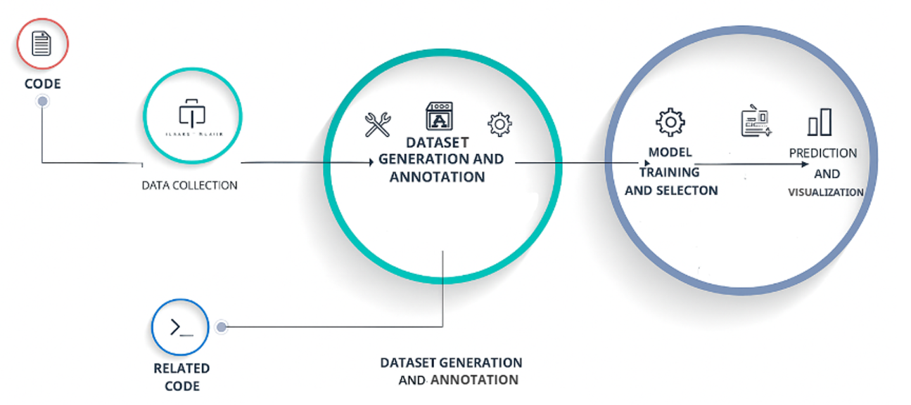
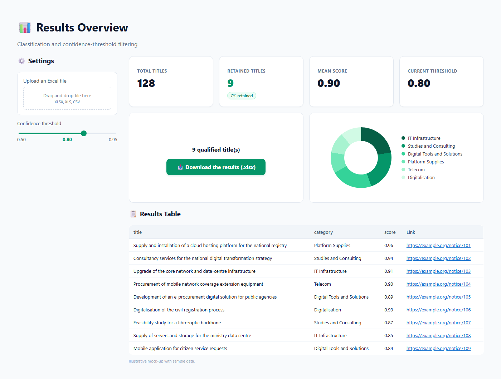

# 🔎 Automation of the Search for ITT and EOI Notices on the Websites of Regulators and National/International Platforms

🎓 *Developed during a summer internship*

> An end-to-end pipeline that **scrapes** tender notices from regulator and procurement portals across Africa, **cleans** them, **classifies** them with a fine-tuned NLP model, and lets you **filter and export** the relevant ones from a Streamlit dashboard.


---

## 🌍 Context & motivation

Calls for Tenders (ITT) and Calls for Expressions of Interest (EOI) are key instruments for transparency and competitiveness in public procurement. They are published on many national and international platforms and on regulators' websites, often in **unstructured, heterogeneous formats**.

| Approach | Limits |
|---|---|
| **Manual monitoring** | Slow, effort-consuming, error-prone on large, scattered volumes |
| **Commercial services / APIs** (e.g. TED) | Do not cover every source, limited filtering for specific needs |
| **This project** | Centralises many sources, extracts and classifies automatically, keeps only what matches the company's business |

**Goal:** capture the maximum number of *relevant* notices from different sources in a shorter time, to support decision-making and market insight.

---

## 📖 Definitions

- **Call for Tenders (ITT)** – A formalised public-procurement procedure (open or restricted). The buyer picks the most economically advantageous offer, without negotiation, using objective criteria announced beforehand.
- **Call for Expressions of Interest (EOI)** – An ad hoc procedure, not provided for by the procurement code, letting a public body invite private initiative around projects of interest, even when the need is not perfectly expressed.
- **Web scraping** – Extracting data from web pages (typically over HTTP) into usable formats such as Excel or CSV.

---

## 🏗️ Architecture



The solution has **five components**:

| # | Component | What it does |
|---|---|---|
| 1 | **Data Collection** | Scrapes EOI/ITT from national and international platforms |
| 2 | **Data Preparation** | Merges, cleans and normalises the data, removes special characters |
| 3 | **Dataset Generation & Annotation** | No labelled dataset existed: titles were annotated manually and augmented with AI-generated titles (Google AI Studio) |
| 4 | **Model Training & Selection** | Trains and compares classifiers, keeps the best one |
| 5 | **Prediction & Visualisation** | Classifies new titles and shows them in an interactive Streamlit app |


---

## ⚙️ Pipeline in detail

### 1️⃣ Data collection – `1_scraping/`
Each website has its own structure, so each gets its own notebook:

- **Static sites** → `requests` + `BeautifulSoup`.
- **Dynamic sites** → `Selenium` with a Chrome WebDriver (pop-ups, "load more" buttons, pagination).
- **PDF notices** (Annexure J) → downloaded and parsed with `PyMuPDF` to extract dates.
- **Translation** of English titles to French with `deep-translator`, relative dates (EXAMPLE: "posted 2 weeks ago") converted to real dates, **expired notices skipped**.
- Output: one `.xlsx` per source in `2_scraped_files/`.

### 2️⃣ Data preparation – `3_cleaning/cleaning.ipynb`
- Merge every scraped Excel file into a single DataFrame.
- Lowercase and strip column names and titles.
- Repair encoding problems (`ftfy`), normalise quotes, dashes and punctuation spacing.
- Normalise `publication_date` and `expiration_date` to `dd-mm-yyyy`.
- Export `data.xlsx`.

### 3️⃣ Dataset generation & annotation
The company defines **six target categories**, each with its own keyword set:

| Category |
|---|
| Studies and Consulting |
| Platform Supplies |
| Digital Tools and Solutions |
| Telecom |
| IT Infrastructure |
| Digitalisation |

- **Manual labelling** of the scraped titles (large volume, high accuracy needed) so the dataset mirrors real notices.
- **Data augmentation:** an API script prompts Google AI Studio to generate titles for each category, increasing the size, balance and diversity of the dataset.

### 4️⃣ Model training & selection – `4_classification/`
Two pretrained transformer models were compared:

| | **CamemBERT**  | **MPNet v2 (SetFit)** |
|---|---|---|
| Base model | `camembert-base` (RoBERTa trained on French OSCAR) | `paraphrase-mpnet-base-v2` |
| Why | Scraped titles are mostly French | Unifies MLM + PLM, strong semantic embeddings |
| Learning rate | 2e-5 | – |
| Batch size | 10 | 8 |
| Epochs | 3 | 1 (memory constraints) |
| Other | AdamW, class weights | 10 iterations |

Metrics: **Accuracy, Precision, Recall, F1-score**.

### 5️⃣ Prediction & visualisation – `5_display/app.py`
The Streamlit app lets you:
- 📤 upload a new `.xlsx`/`.csv` (must contain `title` and `link` columns),
- 🎚️ choose a **confidence threshold** (0.50 – 0.95),
- 🏷️ see the predicted categories,
- 📊 view KPI cards (total / retained / mean score), a donut chart by category and a table with clickable links,
- 📥 download the filtered results as `results.xlsx`.


*Illustrative mock-up of the dashboard with sample data.*


---

## 📈 Results

Both models were trained on the labelled + AI-augmented title dataset (6 balanced categories) with an 80/20 stratified train/test split.

### Model comparison

| Model | Train / test titles | Accuracy | Precision | Recall | F1-score |
|---|---|---|---|---|---|
| **CamemBERT** (selected) | 8,113 / 2,029 | **0.8773** | **0.8781** | **0.8773** | **0.8775** |
| MPNet v2 (SetFit) | 7,182 / 1,796 | 0.8552 | 0.8545 | 0.8552 | 0.8542 |

Precision, recall and F1 are weighted averages. CamemBERT scores about 2 points higher on every metric, so it is the deployed model. The two test sets are different splits (the MPNet run used a slightly smaller dataset), so the comparison is indicative.

### CamemBERT – classification report

| Category | Precision | Recall | F1-score | Support |
|---|---|---|---|---|
| Digitalisation | 0.94 | 0.95 | 0.94 | 324 |
| Studies and Consulting | 0.95 | 0.92 | 0.93 | 320 |
| Platform Supplies | 0.92 | 0.89 | 0.90 | 315 |
| IT Infrastructure | 0.79 | 0.81 | 0.80 | 412 |
| Digital Tools and Solutions | 0.84 | 0.86 | 0.85 | 340 |
| Telecom | 0.88 | 0.86 | 0.87 | 318 |

### CamemBERT – confusion matrix (rows = true class, columns = predicted)

| True \ Predicted | Digitalisation | Studies & Consulting | Platform Supplies | IT Infrastructure | Digital Tools | Telecom |
|---|---|---|---|---|---|---|
| **Digitalisation** | **307** | 4 | 2 | 6 | 4 | 1 |
| **Studies & Consulting** | 18 | **296** | 1 | 4 | 1 | 0 |
| **Platform Supplies** | 1 | 1 | **284** | 19 | 10 | 0 |
| **IT Infrastructure** | 1 | 9 | 19 | **332** | 22 | 29 |
| **Digital Tools** | 1 | 0 | 3 | 28 | **292** | 16 |
| **Telecom** | 0 | 0 | 0 | 22 | 27 | **269** |

### Training setup
- **CamemBERT:** 3 epochs (2,436 steps), final training loss 0.49, about 73 minutes on GPU.
- **MPNet v2:** 1 epoch, 143,640 sentence pairs generated by SetFit.

### Analysis
- Strong, balanced performance across all six categories.
- **IT Infrastructure** is the weakest class (F1 0.80). It is confused mostly with **Telecom** (29), **Digital Tools** (22) and **Platform Supplies** (19), categories whose titles use overlapping vocabulary.
- **Digital Tools ↔ Telecom** and **Digital Tools ↔ IT Infrastructure** are the other main confusion pairs.
- **Digitalisation** and **Studies and Consulting** are the cleanest classes (F1 0.94 and 0.93).
- Signs of overfitting appear after 3 epochs, so training stops there as a balance between fit and generalisation.

---

## 🛠️ Installation

**Prerequisites:** Python 3.12, Google Chrome + [ChromeDriver](https://sites.google.com/chromium.org/driver/), and optionally an NVIDIA GPU (CUDA 12.x) for training.

```bash
# scraping
pip install selenium beautifulsoup4 requests lxml webdriver-manager dateparser deep-translator
# documents / OCR
pip install PyMuPDF pytesseract pdf2image pillow
# data
pip install pandas numpy openpyxl unidecode tqdm ftfy langdetect
# ML
pip install scikit-learn datasets transformers setfit
pip install torch torchvision torchaudio --index-url https://download.pytorch.org/whl/cu122   # GPU build
# app
pip install streamlit plotly
```

In VS Code / Jupyter, select the GPU kernel (`torchgpu`) before running the training notebooks.

---

## ▶️ Usage

1. **Scrape** – create the `2_scraped_files/` folder if it does not exist, then run the notebooks in `1_scraping/` (outputs go to `2_scraped_files/`).
2. **Clean** – run `3_cleaning/cleaning.ipynb` to produce `data.xlsx`.
3. **Train** – run `4_classification/camembert/camembert.ipynb` on the labelled dataset.
4. **Launch the dashboard**
   ```bash
   python -m streamlit run 5_display/app.py
   ```
   > The scraped data, the labelled dataset and the trained weights are not stored in the repository. The app loads the model from `4_classification/camembert/my_model` (path resolved relative to the project). The trained weights are not stored in the repository, so train the model first (step 3) or place your own copy there.

---

## ⚖️ Responsible scraping

- Only publicly available procurement notices are collected.
- Respect each website's terms of use and `robots.txt`. At the time of writing, none of the sources' `robots.txt` files disallowed the scraped pages.
- Keep delays between requests and do not overload the servers.
- Scraped data may contain contact details, so do not redistribute it without checking the source's terms.

---

## 🧰 Tech stack

| Area | Tools |
|---|---|
| 🕷️ Scraping | Selenium, BeautifulSoup, Requests |
| 🧹 Processing | Pandas, NumPy, ftfy |
| 📄 Documents | PyMuPDF, Pillow, pytesseract |
| 🧠 NLP / ML | Hugging Face Transformers, SetFit, scikit-learn, PyTorch (GPU) |
| 🚀 Deployment | Streamlit, Plotly |
| 💻 Environment | Python in VS Code with Jupyter |
